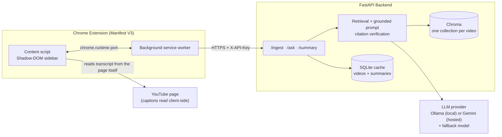

# YouTube ChatBot

A Chrome extension that adds an AI sidebar next to any YouTube video. It answers questions about the
video using only its own transcript, cites the exact timestamp each claim comes from, and jumps the
player there on click. It also auto-generates a summary and key points when the sidebar opens.


## Why this exists

Watching a 40-minute tutorial to find one explanation is slow. This answers "where does it cover X?"
in seconds, with a citation you can click to verify it yourself — not a black-box summary you have to
trust.

## Architecture



**Why the transcript is read in the browser, not the server:** YouTube blocks transcript requests
from most cloud/datacenter IPs (Render, Railway, AWS, …), so a server trying to fetch transcripts
itself gets refused once deployed. The extension reads the transcript from the page it's already on —
which YouTube never blocks, since it looks like an ordinary viewer — and sends it to the backend. The
backend still fetches transcripts itself when running locally (and for the evaluation script below).

## Key design decisions

- **Time-window chunking** (75s windows, 15s overlap) instead of fixed-size text chunks, so each chunk
  keeps a real, seekable start time.
- **Citation verification**: the model's `[M:SS]` citations are checked against the chunks actually
  retrieved. A timestamp inside a retrieved chunk is snapped to that chunk's real start; an invented
  one is stripped from the answer rather than shown to the user.
- **Streaming via Server-Sent Events**: `sources` (what was retrieved) → `token` (the answer as it's
  generated) → `final` (the citation-checked answer). The extension shows tokens live, then swaps in
  the verified version.
- **Swappable LLM/embedding provider** (`app/providers.py`): one environment variable (`LLM_PROVIDER`)
  switches between a local Ollama model and a hosted Gemini model, with automatic fallback to a second
  Gemini model if the first times out or errors — free-tier models occasionally do.
- **Follow-up questions**: a short follow-up ("explain that more") is searched together with the
  previous question, and the model is told earlier messages are context only — citations must still
  come from the current excerpts, not from memory of the conversation.
- **Caching**: a video's transcript, chunks and summary are cached (SQLite + Chroma), so re-opening a
  video is near-instant and never re-embeds or re-fetches.

## Setup

### Backend
```bash
cd backend
python -m venv .venv && .venv\Scripts\activate      # Windows; use source .venv/bin/activate on macOS/Linux
pip install -r requirements.txt
cp .env.example .env
# Fill in .env: LLM_PROVIDER (ollama or gemini), GOOGLE_API_KEY if using gemini
uvicorn app.main:app --port 8000
```
Local use with Ollama needs `ollama pull qwen2.5:3b` and `ollama pull mxbai-embed-large` first.

### Extension
1. `chrome://extensions` → enable Developer mode → **Load unpacked** → select `extension/`.
2. Copy `extension/config.example.js` to `extension/config.js` and set `BACKEND_URL` (and `API_KEY` if
   the backend requires one).
3. Open any YouTube video — the sidebar appears automatically.

### Tests
```bash
cd backend
python -m pytest -q
```
Runs entirely offline against fakes (no API key, no network, no cost) — 46 tests covering chunking,
citation verification, the API surface, follow-up handling, hardening, and provider switching.

### Docker
```bash
cd backend
docker build -t yt-assistant .
docker run --rm -p 8000:8000 --env-file .env -e DATA_DIR=/data yt-assistant
```

## Evaluation

*[Fill in after running the eval script: N questions across N videos, answer-correctness %,
timestamp-correctness %, median time-to-first-token, cache hit vs. miss latency.]*

| Metric | Result |
|---|---|
| Questions evaluated | — |
| Answer correctness | — |
| Timestamp correctness | — |
| Median time to first token | — |
| First ingest vs. cached ingest | — |

## Known limitations

- A 3B local model sometimes cites only once per answer or not at all; the sidebar falls back to
  showing "related moments" in that case.
- Embedding quality for non-English questions depends on the embedding model in use.
- Free-tier hosted model quotas can rate-limit under heavy use; the fallback model absorbs occasional
  failures but not sustained load.

## Stack

FastAPI · LangChain · Chroma · SQLite · youtube-transcript-api · Ollama / Gemini · Chrome Extension
(Manifest V3, vanilla JS, Shadow DOM) · pytest · Docker
